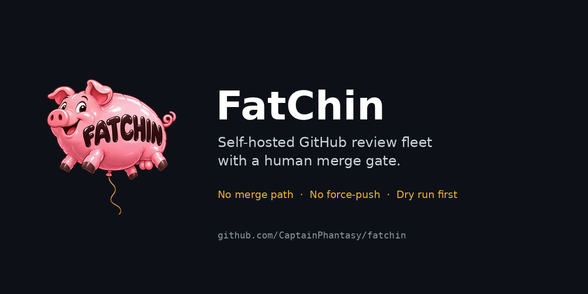
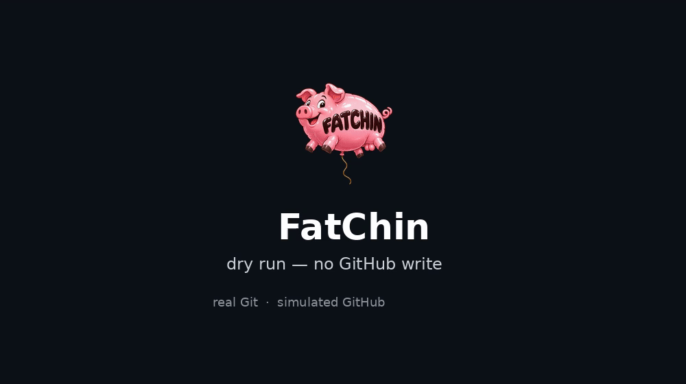
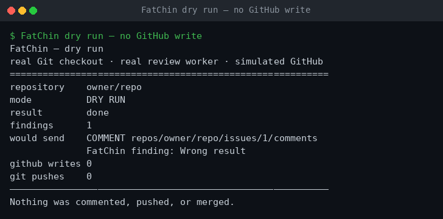
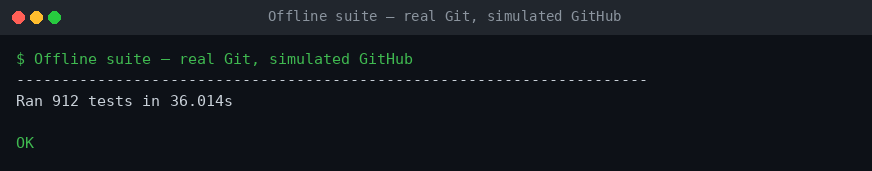

# FatChin



**A self-hosted GitHub review fleet with a human merge gate.**

A push goes in. A reviewed, checked, corrected pull request comes out — with a
second worker reviewing the correction, and you making the merge decision.

FatChin runs on your machine, uses your model endpoint, and never merges. It is
standard-library Python, a vanilla-JS interface, and no runtime dependencies.

```text
push ──▶ draft PR ──▶ review ──▶ specific fix ──▶ independent review ──▶ ready to merge
                                                                              │
                                                                        you merge
```

## Why it exists

Review bots are useful until the per-seat invoice arrives, and autonomous
agents are useful until one writes to `main`. FatChin takes the middle path:

- **Whole-account orchestration.** A fleet of workers covers every repository
  you grant, with per-repository concurrency and policy.
- **Bring your own model.** Any OpenAI-compatible chat endpoint with tool
  calling. No vendor account, no per-seat fee.
- **The human keeps the merge.** There is no merge code path. It cannot merge,
  approve, or force-push.
- **Evidence, not vibes.** Checks run in a sandbox, findings must cite a line,
  and a correction is reviewed by a different worker slot.
- **A dry run that writes nothing.** Every intended comment, pull request,
  push, and resolution is recorded first.

## Demo

[](docs/screenshots/demo.mp4)

The recording runs the real worker against a real Git checkout with a
**simulated GitHub**. It finds one defect, records the exact comment it would
send, and sends nothing. Click the animation for the MP4.





## Safety model

| Boundary | What it means |
| --- | --- |
| No merge path | The fleet can mark a pull request ready; merging stays with you. |
| No force-push | A correction is an ordinary commit on a branch. |
| Draft first | A pushed feature branch becomes a **draft** pull request; a draft cannot merge. |
| Sandboxed commands | Checks and model-issued commands run in bubblewrap with no network, no account files, and read-only Git metadata. Missing bubblewrap is a refusal, not a fallback. |
| Capability limits | Fleet workers can read, list, and edit allowlisted files. They have no shell or GitHub tool. |
| Write admission | Every remote write records its intent first and reconciles the receipt afterwards. |
| Publication caps | A bounded number of public writes per repository per day, shared by all slots. |
| Repository policy | Personal namespaces in by default; organisation namespaces out until named. |
| Dry run | Records exactly what it would send; sends nothing. |

No prompt is treated as a control. The barriers are in code, and the tests
exercise them.

## Requirements

- Linux with `git`, `gh` (authenticated), and `bubblewrap` (`bwrap`).
- Python 3.11 or newer.
- An OpenAI-compatible chat endpoint with tool calling, and a key.
- Optional: a systemd user session for the two supplied units.

## Quick start

```sh
git clone https://github.com/CaptainPhantasy/fatchin.git
cd fatchin
python3 -m pip install -e .

fatchin init-config --path ~/.config/gha-worker/config.toml
# edit state_dir, worktree_root, [[repos]], and [model]

mkdir -p ~/.config/gha-worker
printf 'GHA_MODEL_API_KEY=your-key\n' > ~/.config/gha-worker/env
chmod 600 ~/.config/gha-worker/env

fatchin-web --host 127.0.0.1 --port 18465 \
  --config ~/.config/gha-worker/config.toml \
  --env-file ~/.config/gha-worker/env
```

Open <http://127.0.0.1:18465>.

To listen beyond loopback, supply an admin token. The server refuses to bind
remotely without one:

```sh
fatchin-web --host 0.0.0.0 --port 18465 --token "$(python3 -c 'import secrets;print(secrets.token_urlsafe(32))')"
```

The browser asks for that token once and stores it in session storage. `/api/*`
requires `Authorization: Bearer <token>`.

### First run: dry run

1. Open **Agent fleet**.
2. Choose your member account and a results folder.
3. Tick **Dry run**, pick one small repository, and dispatch.
4. Read `dry_run_actions` in the item result and in the report folder.
5. Stop the fleet. Dispatch again without **Dry run** when the record matches
   what you would have approved.

A terminal runner does the same:

```sh
bash scripts/demo-dry-run.sh owner/repository
```

## Configuration

The example config documents every field. The important ones:

```toml
state_dir = "/home/you/.local/state/gha-worker"
worktree_root = "/home/you/.local/state/gha-worker/worktrees"

[[repos]]
owner = "you"
name = "project"
base_branch = "main"
checks = ["python3 -m unittest discover -s tests"]

[model]
base_url = "http://127.0.0.1:8080/v1"
model_id = "your-model"          # must support tool calling
auth_mode = "env"                # or "broker-lease" for a lease broker

[fleet_policy]
personal_default = "include"
org_default = "exclude"
# include = ["YourOrg/important"]
```

Model calls are counted per job and per UTC day. A fleet can also carry a total
`max_calls_total`; it pauses when the run budget is exhausted.

## Command line

```sh
fatchin status                 # read saved state, no model call
fatchin run                    # daemon: polls configured repos and drains jobs
fatchin once --repo you/project
fatchin provider-check         # one small live model call
fatchin init-config
```

The browser and the command line share the same queue, executor, and
configuration.

## How a task runs

1. Read the issue, pull request, or review comments.
2. Create a separate Git checkout.
3. Let the model inspect and edit code through a restricted tool set.
4. Run the repository's configured checks locally, in the sandbox.
5. Inspect automation and branch state before any write.
6. Publish only what the evidence supports: a commit, a pull request, a reply.
7. Write the patch and a report to the destination you chose.

The fleet adds an independent reviewer: a correction is reviewed by a different
slot, and work that passes appears in **Ready to merge**.

## Limitations

- GitHub only.
- One trusted operator, one machine. The store is a JSON document with a global
  lock, not a database.
- The admin token protects the HTTP API; it is not a multi-tenant identity
  system.
- Free private repositories cannot expose rulesets through the GitHub API. That
  is recorded as “unverified”, never as “safe.”
- A passing check means that check passed. No configured checks means
  verification is unknown.
- The model is replaceable; the evidence is the product.

## Security

See [SECURITY.md](SECURITY.md) for the threat model and reporting instructions.

## Contributing

See [CONTRIBUTING.md](CONTRIBUTING.md). The suite is offline and runs with:

```sh
PYTHONPATH=src python3 -m unittest discover -s tests -t .
```

## License

AGPL-3.0-or-later. See [LICENSE](LICENSE).
